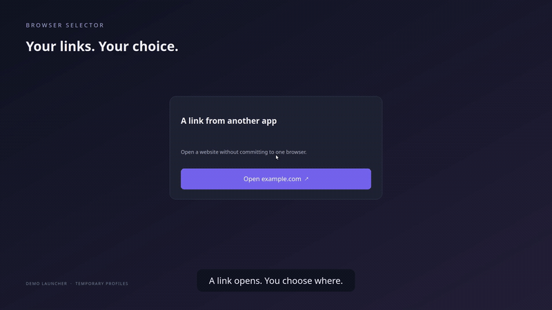

# Browser Selector

A desktop popup for external HTTP/HTTPS links. Choose a browser or a specific
profile, copy the URL, or close the popup. Links inside browsers keep their
normal behavior. No browser extensions or background service are needed.

[](docs/media/demo.mp4)

[Watch or download the 1080p video](docs/media/demo.mp4) · About 20 seconds. Recorded on
an isolated Linux desktop with temporary profiles and no personal accounts.

The popup starts with collapsed, clickable browser rows with chevrons. Click a
browser to reveal only its named profiles; browsers without discoverable profiles
open directly. An icon beside the URL copies the full link. Keyboard navigation
and closing with Escape are supported. It follows the system's light/dark appearance, including
changes while the popup is open. On Linux it reads the desktop appearance portal,
with native Qt appearance/palette hints as a fallback. New links use the updated
UI immediately; already-open chooser windows need to be closed and reopened.

Download packaged apps from [GitHub Releases](https://github.com/HariTP/browser-selector/releases).
The downloads include Python and Qt; no Python installation is needed.

## Windows

Download the `windows-x86_64-setup.exe` installer from Releases and run it. At the
end of setup, select Browser Selector for HTTP and HTTPS in Windows Default Apps.
The installer runs per-user without requiring administrator privileges.

For the portable ZIP, extract the entire folder to a permanent location and run
`browser-selector.exe --setup` to register it and open Default Apps. Keep its
`_internal` folder beside the executable. Windows downloads are currently unsigned.

To install from source instead:

```powershell
python -m venv .venv
.venv\Scripts\python -m pip install .
.venv\Scripts\python scripts\register_windows.py
```

## macOS

Download the `macos-arm64.dmg` for Apple Silicon or `macos-x86_64.dmg` for Intel.
Drag Browser Selector into Applications, launch it, and select it as the default
web browser in System Settings. The first releases use ad-hoc signing rather
than Developer ID signing/notarization, so macOS may warn or block the app.

To build from source instead:

```bash
python3 -m venv .venv
.venv/bin/python -m pip install . pyinstaller
.venv/bin/python scripts/build_release.py
```

Safari is supported as a browser choice; selecting a specific Safari profile is
not available.

## Linux

For Ubuntu 22.04+/Debian 12+, download the `.deb` from Releases and install it
through your software installer or `sudo apt install ./browser-selector-*.deb`.
Then select Browser Selector as the default web browser in desktop Settings.

For the portable `.tar.gz`, extract the entire folder to a permanent location and
run `./browser-selector --setup --make-default` inside it. Keep the `_internal`
folder beside the executable. Portable builds still need system desktop libraries;
the `.deb` declares those dependencies for your package manager.

If you previously installed this checkout as the default handler, run the packaged
`browser-selector --setup --make-default` to replace the old launcher path.
Use `browser-selector --setup --restore-defaults` to restore saved HTTP(S) defaults.

To install from source instead:

```bash
python3 -m venv .venv
.venv/bin/python -m pip install -e .
.venv/bin/browser-selector --list
.venv/bin/browser-selector 'https://example.com'
.venv/bin/python scripts/register_linux.py --default
```

The registration is per-user; it needs no root privileges. Keep this checkout and
its virtual environment at the installed path. Run the registration script again
after moving them. Omit `--default` to register without changing defaults.
On Debian/Ubuntu X11 desktops, Qt also requires `libxcb-cursor0` (install using
`sudo apt install libxcb-cursor0`). Wayland sessions use Qt's Wayland backend.

To restore your previous HTTP/HTTPS defaults:

```bash
.venv/bin/python scripts/register_linux.py --restore
```

Other apps must use the system default browser. Apps with a built-in webview or an
explicit browser preference can bypass the chooser. This app only handles HTTP
and HTTPS, not HTML files or custom protocols. Separate simultaneous invocations
produce separate chooser windows; multiple links received together share a picker.

## Browser/profile support

- Registered Linux browsers are discovered from desktop entries, including Snap
  and Flatpak exports. Duplicate registrations are collapsed.
- Chrome, Chromium, Brave, Edge and Vivaldi: profiles are read from local metadata
  and selected with explicit data-directory and profile-directory arguments.
- Firefox and compatible browsers: profiles listed in `profiles.ini` are selected
  by their absolute path. New profile managers or forks with different storage
  layouts may need adapters. Containers are not profiles and are not supported.
- Safari and browsers without a supported profile adapter appear as browser-only
  choices. Safari chooses its profile using its own rules.
- Browsers without discoverable profiles use the browser's normal behavior; this
  is not a guarantee of a particular last-used profile.

Discovery is limited to standard paths and current-user profiles. Portable/custom
data directories and browser channels may need future adapters. Browser metadata
is read only; no cookies, passwords or browsing history are read. URLs are passed
as process arguments, without invoking a shell, and are neither logged nor sent
to a service. Missing executables and immediate browser errors keep the picker
open; a browser's later internal error may require retrying the link.

## Building releases

```bash
python -m pip install . 'pyinstaller>=6.10,<7'
python scripts/build_release.py
```

Run the build on the OS/CPU you are targeting. Artifacts and SHA-256 checksums go
into `release/`. Windows builds require Inno Setup 6; Linux `.deb` builds require
`dpkg-deb`. GitHub Actions builds all supported platforms when a matching `v*` tag
is pushed, checks that each bundled app can construct its GUI, and attaches the
packages to a prerelease. A manual workflow run builds downloadable Actions
artifacts without publishing a release.

## Verification

```bash
.venv/bin/python -m unittest discover -s tests -v
QT_QPA_PLATFORM=offscreen .venv/bin/python -m unittest tests.test_gui -v
```

`--dry-run` opens the real chooser but prints the selected launch command instead
of opening a browser. The Linux smoke-test script starts Chrome with temporary
profiles on a virtual display and checks that URLs reach the selected profile;
it does not touch your existing browser profiles. Run the Firefox check from an
active desktop terminal; Snap Firefox may not be able to access a virtual X11
display:

```bash
.venv/bin/python scripts/smoke_linux.py
.venv/bin/python scripts/smoke_linux.py --browser brave-browser
.venv/bin/python scripts/smoke_firefox.py
```

Verified on the development Linux machine: real Chrome and Brave profile routing
on X11, cold/warm Snap Firefox routing on Wayland, chooser rendering on the actual
Wayland desktop, and HTTP/HTTPS default-handler delivery through `xdg-open`.
Release builds check bundled GUI startup on Windows and macOS; interactive browser
routing there still needs testing. Other Linux distributions, Flatpak variants,
and multiple simultaneous Firefox profiles still need testing.

## Recording the demo

`scripts/record_demo.py` records the actual chooser and browser handoff on a
temporary X11 desktop, then adds smooth zooms and captions. It requires FFmpeg,
Xvfb, xdotool, Chrome, Brave, and the Qt X11 dependencies listed above.

```bash
.venv/bin/python scripts/record_demo.py
```

The MP4, animated GIF, and poster are written to `docs/media/`. Browser profiles
and URL-handler configuration are temporary; your desktop is never captured and
your current default browser is not changed.
